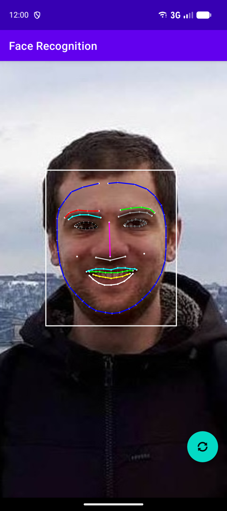

# Face Recognition

An Android prototype, built in 2020, that finds faces in the live camera feed
and traces their features in real time: the face outline, eyebrows, eyes, nose
and lips.

<p align="center">
  
</p>

## What it does

- Shows the camera preview full screen and draws on top of it, for every frame:
  - a bounding box around each detected face,
  - the contour points ML Kit finds,
  - coloured outlines of the face, eyebrows, eyes, nose and lips.
- Switches between the front and back camera with the button in the corner. The
  selected camera is kept when the screen rotates.
- Zooms with a pinch gesture.
- Asks for the camera permission on first launch, and explains why before
  closing if it is denied.

Everything runs on the device. No image ever leaves the phone.

## How it works

```
Camera ──► Preview ─────────────────────────────► PreviewView
   │
   └─────► ImageAnalysis ──► ML Kit face detector ──► GraphicOverlay
           (latest frame)     (contours)                (drawn on top)
```

1. **Camera.** `CameraManager` binds two CameraX use cases to the activity's
   lifecycle: a `Preview` shown in a `PreviewView`, and an `ImageAnalysis` that
   hands frames to an analyzer on a background thread. The analysis keeps only
   the latest frame, so slow detection drops frames instead of building a
   backlog.
2. **Detection.** `BaseImageAnalyzer` wraps each frame in an ML Kit
   `InputImage` together with its rotation. `FaceContourDetectionProcessor` runs
   the ML Kit face detector in fast mode with all contours enabled. The frame is
   released as soon as detection finishes, which lets the next one in.
3. **Results.** Detected faces go to a small `DetectionListener`, along with the
   size of the upright frame they were found in. `MainActivity` turns each face
   into a `FaceContourGraphic` and passes them to the overlay.
4. **Drawing.** `GraphicOverlay` is a transparent view over the preview.
   `ImageToViewMapper` converts image coordinates into view coordinates the same
   way the preview is displayed: scaled to fill the screen, centred, and mirrored
   for the front camera so the drawing lines up with the selfie view.

### Structure

```
app/src/main/java/app/teknikcell/facerecognition/
├── MainActivity.kt              wires the parts together, permission, UI events
├── camera/
│   └── CameraManager.kt         CameraX preview, analysis, lens switching, zoom
├── detection/
│   ├── BaseImageAnalyzer.kt     camera frame → ML Kit, frame lifecycle
│   ├── DetectionListener.kt     callback for detection results
│   └── FaceContourDetectionProcessor.kt   ML Kit face contour detector
└── overlay/
    ├── GraphicOverlay.kt        view that draws graphics over the preview
    ├── FaceContourGraphic.kt    box, points and outlines for one face
    └── ImageToViewMapper.kt     image → view coordinate mapping
```

The three packages do not depend on each other. `CameraManager` accepts any
`ImageAnalysis.Analyzer` and the overlay accepts any `Graphic`, so another
detector (barcodes, text, objects) could reuse the camera and drawing code
unchanged.

## Tech

| Area | Library / tool |
| --- | --- |
| Language | Kotlin |
| Camera | CameraX core, camera2, lifecycle |
| Camera preview | CameraX view (`PreviewView`) |
| Face detection | ML Kit face detection (Google Play services) |
| UI | AppCompat, Core KTX, ConstraintLayout, Material Components |
| Build | Android Gradle Plugin, Gradle |

The face detection model is not bundled in the APK. Google Play services
downloads it; the `com.google.mlkit.vision.DEPENDENCIES` entry in the manifest
asks for it when the app is installed from the Play Store. This keeps the APK
small, but the device needs Google Play services, and detection only starts once
the model is available.
